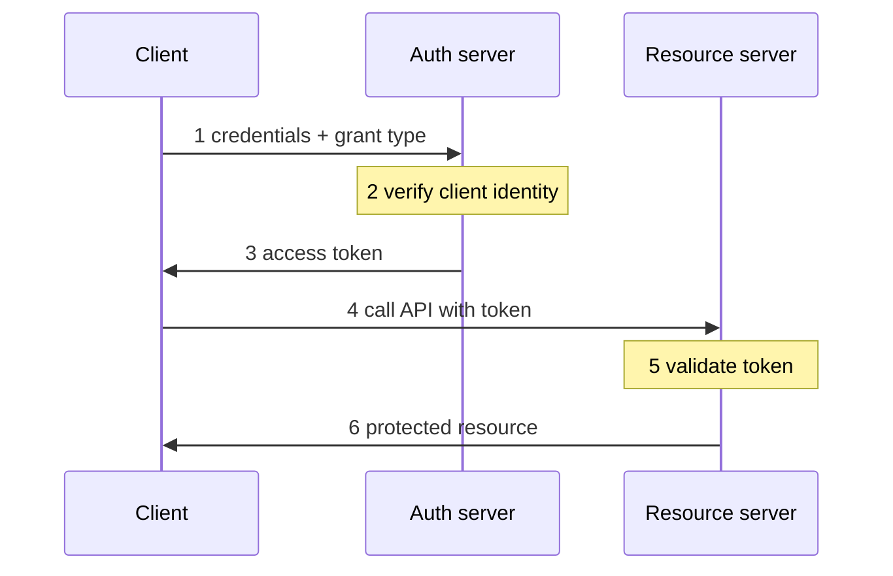

# Client Credentials Flow

The [[OAuth]] grant for machine-to-machine access, where no user is
involved. The client is the principal, acting on its own behalf rather than
a person's, so there is no login page, no consent step, no redirect and no
authorization code. It authenticates itself directly to the authorization
server and gets an access token back in a single request.

It exists because with no resource owner to delegate anything, the client's
own credentials are the whole basis for trust. That only works for
confidential clients that can keep a secret - the opposite situation to
[[PKCE Flow]], which exists for clients that cannot.

## Sequence

Source: RFC 6749 section 4.4, as summarised at oauth.net/2/grant-types/client-credentials. Step ordering beyond the token request and response is general knowledge, no verified source.
