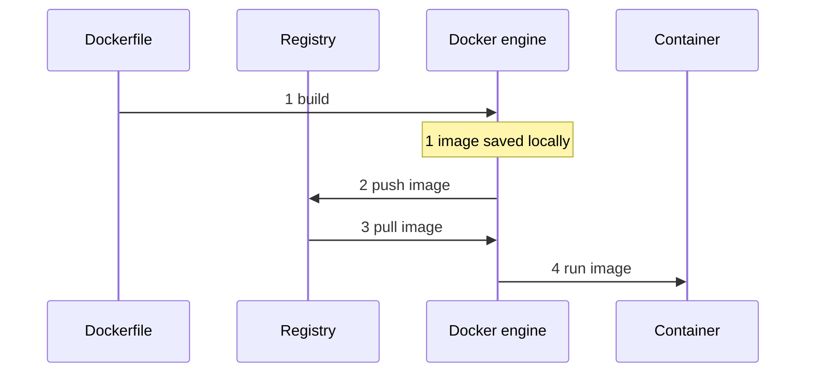

# Container Image

A read-only, packaged filesystem plus metadata (what to run), built from a
[[Dockerfile]] by the [[Docker]] engine. It is a template, not a running
thing: starting it creates a [[Container]], an isolated process using that
image. The same image can be started many times.

The [[Dockerfile]] only matters at build time. To reach another machine, the
image is pushed to a [[Container Registry]], and the engine on the other
machine pulls it from there before running it.

## Sequence

Source: general Docker knowledge, no verified vault or doc source. See also
[[Containerisation]].
