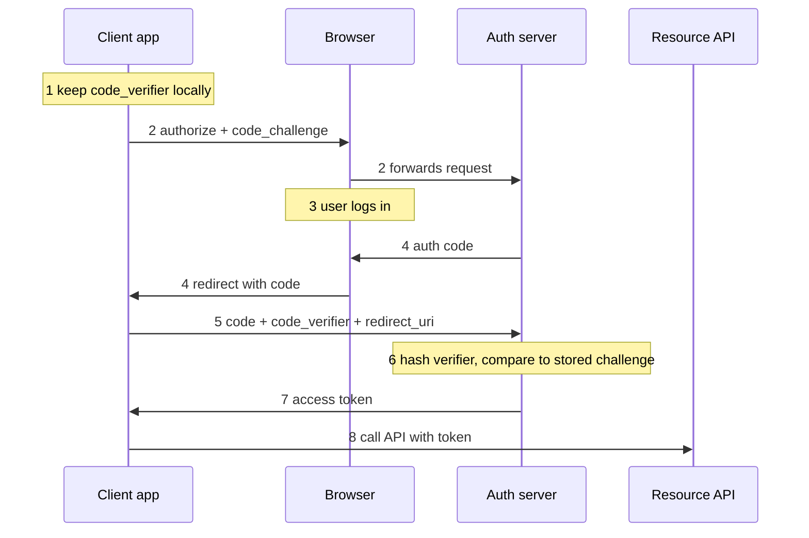

# PKCE Flow

Fixes a gap in [[OAuth]]'s Authorization Code flow for clients that can't
keep a secret (mobile apps, single-page apps) - anyone can decompile or
inspect the app and find any embedded "secret," so proving the client's
identity at code-exchange via a client secret doesn't work for them.
Without a fix, anyone who intercepts the authorization code (it travels
through the browser's redirect, a comparatively exposed channel) could
exchange it for a real access token themselves.

The fix: the client generates a random secret, the **code_verifier**, kept
only locally - never sent anywhere. It sends a one-way hash of that, the
**code_challenge**, at the start of the flow. The Authorization Server
stores the challenge alongside the authorization code it issues. When the
client exchanges the code for a token, it sends back the raw verifier - the
server hashes it and checks it matches the stored challenge.

An interceptor who steals only the authorization code never saw the
verifier (only its hash was ever transmitted, and a hash can't be
reversed), so they can't complete the exchange even with the stolen code in
hand - proof of possession, not a shared secret.

## Sequence

